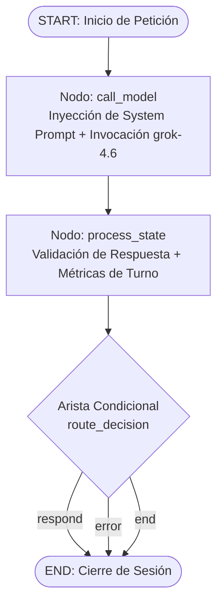

# 🚗 ServiceSync Agent (Hito S1)

> **Asistente operativo automotriz inteligente para triaje de servicio, diagnóstico preliminar y atención al cliente, impulsado por LangGraph y la API de Plática con el modelo `grok-4.6`.**

---

## 📋 Tabla de Contenidos
1. [Descripción del Problema que Resuelve](#-descripción-del-problema-que-resuelve)
2. [Arquitectura Técnica](#-arquitectura-técnica)
   - [Grafo de Ejecución (LangGraph)](#grafo-de-ejecución-langgraph)
   - [Gestión de Estado y Memoria Conversacional](#gestión-de-estado-y-memoria-conversacional)
   - [Conexión con Plática API y Headers HTTP](#conexión-con-plática-api-y-headers-http)
   - [Mitigación Estricta de Alucinaciones](#mitigación-estricta-de-alucinaciones)
3. [Estructura del Proyecto](#-estructura-del-proyecto)
4. [Prerrequisitos](#-prerrequisitos)
5. [Instrucciones de Instalación y Configuración](#-instrucciones-de-instalación-y-configuración)
6. [Guía de Ejecución y Pruebas](#-guía-de-ejecución-y-pruebas)
   - [Diagnóstico de Conectividad HTTP](#1-diagnóstico-de-conectividad-http)
   - [CLI Interactivo de Conversación Continua](#2-cli-interactivo-de-conversación-continua)
   - [Simulación End-to-End Automatizada](#3-simulación-end-to-end-automatizada)
   - [Pruebas Unitarias de Componentes](#4-pruebas-unitarias-de-componentes)
7. [Políticas y Reglas del Sistema](#-políticas-y-reglas-del-sistema)

---

## 🎯 Descripción del Problema que Resuelve

En la industria automotriz y en los talleres de servicio mecánico, la etapa inicial de recepción y atención al cliente presenta desafíos operativos recurrentes:
1. **Pérdida de tiempo en triaje:** Los asesores dedican tiempo excesivo recopilando datos básicos del automóvil (marca, modelo, año, kilometraje) y síntomas dispersos antes de generar una orden de servicio.
2. **Alucinaciones financieras (precios inventados):** Los modelos de lenguaje convencionales tienden a fabricar tarifas o precios fijos de refacciones y mano de obra cuando un cliente pregunta "¿cuánto cuesta?". En mecánica, esto es inviable, ya que los costos dependen de la viscosidad del aceite, tolerancias de discos, marca de refacciones y estado del chasis.
3. **Ofrecimiento de servicios fuera de catálogo:** Frecuentemente los asistentes virtuales prometen servicios especializados (como hojalatería mayor, blindaje o modificaciones clandestinas de motor) que el taller no realiza, generando inconformidad e incumplimiento.
4. **Desatención de emergencias mecánicas:** Falta de protocolos para identificar fallas críticas inmediatas (falla de frenos, pedal esponjoso, alertas de temperatura o baja presión de aceite), comprometiendo la seguridad vial del cliente.

**ServiceSync Agent** resuelve estos problemas actuando como el **primer filtro operativo**:
- Aplica un **rol técnico, amable pero directo**, centrado en la resolución rápida.
- Aplica **reglas estrictas contra alucinaciones**, impidiendo la invención de precios o servicios fuera del contexto base oficial.
- Orienta y prioriza la **seguridad mecánica**, advirtiendo al conductor si el vehículo no debe rodarse.
- Mantiene **memoria contextual de largo plazo** en la sesión gracias a la persistencia por hilos (`thread_id`) en LangGraph.

---

## 🏗 Arquitectura Técnica

### Grafo de Ejecución (LangGraph)

El flujo de control de ServiceSync Agent está modelado como un grafo de estados (`StateGraph`) que separa claramente la invocación del modelo de la validación y toma de decisiones de enrutamiento:



- **`call_model`**: Asegura que el prompt del sistema y el catálogo oficial estén presentes en la cabecera del contexto. Invoca la instancia del modelo `grok-4.6` a través del cliente configurado.
- **`process_state`**: Inspecciona la respuesta producida, verifica que el contenido sea válido, actualiza el conteo de turnos y registra cualquier condición anómala.
- **`route_decision` (Conditional Edge)**: Evalúa la acción siguiente (`next_step`). En esta fase S1, permite responder de forma fluida y transparente directamente al usuario.

### Gestión de Estado y Memoria Conversacional

El estado global está tipado mediante `AgentState` (`TypedDict`):

```python
class AgentState(TypedDict):
    messages: Annotated[list[BaseMessage], add_messages]
    next_step: str
    turn_count: int
    vehicle_data: dict[str, Any]
    error: Optional[str]
```

- **`messages` con `add_messages`:** Gestiona el historial acumulado de `HumanMessage` y `AIMessage`.
- **`MemorySaver` Checkpointer:** Cada conversación se indexa mediante un `thread_id` único. Cuando el usuario envía múltiples mensajes de seguimiento, LangGraph recupera el estado previo y preserva la memoria de los datos del vehículo.

### Conexión con Plática API y Headers HTTP

La integración utiliza la interfaz de compatibilidad OpenAI v1 de LangChain (`ChatOpenAI`), apuntando directamente al endpoint asignado:

- **Base URL:** `https://api.reto.pltk.mx/v1`
- **Modelo:** `grok-4.6`
- **Headers HTTP Requeridos:**
  ```http
  Authorization: Bearer $RETO_KEY
  Content-Type: application/json
  ```

### Mitigación Estricta de Alucinaciones

El sistema incorpora tres barreras para impedir alucinaciones:
1. **Catálogo Oficial Anclado (`src/catalog.py`):** Define el alcance exhaustivo de los servicios permitidos (mantenimiento preventivo, frenos, alineación/balanceo, diagnóstico OBD-II, sistema de refrigeración) y una lista explícita de servicios no soportados.
2. **Regla de Oro Anti-precios:** NUNCA se inventan costos numéricos. Se instruye al cliente que las cotizaciones requieren toma de datos de motor y revisión en mostrador/taller.
3. **Regla Fundamental en System Prompt (`src/prompts.py`):**
   > *"No inventes precios ni servicios que no estén en tu contexto base."*

---

## 📂 Estructura del Proyecto

```text
ServiceSync_Agent/
├── .env                     # Archivo de variables secretas (IGNORADO por git)
├── .env.example             # Plantilla de variables de entorno para despliegue
├── .gitignore               # Configuración estricta de exclusión (.env, .venv, etc.)
├── requirements.txt         # Dependencias reproducibles del proyecto
├── README.md                # Documentación del proyecto (Hito S1)
├── test_connection.py       # Script de diagnóstico de conectividad HTTP a Plática
├── cli.py                   # CLI interactivo con memoria continua para terminal
├── src/
│   ├── __init__.py          # Inicializador del paquete
│   ├── config.py            # Carga de .env, headers HTTP y validaciones
│   ├── catalog.py           # Catálogo oficial de servicios automotrices (Ground Truth)
│   ├── prompts.py           # System Prompt operativo y reglas anti-alucinación
│   ├── state.py             # Definición del esquema AgentState de LangGraph
│   ├── llm_client.py        # Configuración del cliente ChatOpenAI y llamadas HTTP
│   └── graph.py             # Construcción y compilación del StateGraph con MemorySaver
└── tests/
    ├── __init__.py
    ├── test_components.py   # Pruebas unitarias de componentes, prompts y grafo
    └── test_simulation.py   # Simulación conversacional End-to-End automatizada
```

---

## ⚙️ Prerrequisitos

- **Python:** Versión `3.10` o superior (validado en `Python 3.13.7`).
- **Git:** Para control de versiones.
- **Plática API Key (`RETO_KEY`):** Llave de autenticación provista para el reto.

---

## 🚀 Instrucciones de Instalación y Configuración

### 1. Clonar el Repositorio
```bash
git clone https://github.com/JuanGualdronGallo1203/ServiceSync_Agent.git
cd ServiceSync_Agent
```

### 2. Crear y Activar el Entorno Virtual

**En Windows (PowerShell):**
```powershell
python -m venv .venv
.\.venv\Scripts\Activate.ps1
```

**En Linux / macOS (Bash):**
```bash
python3 -m venv .venv
source .venv/bin/activate
```

### 3. Instalar Dependencias
```bash
python -m pip install --upgrade pip
pip install -r requirements.txt
```

### 4. Configurar las Variables de Entorno

Copia el archivo de plantilla `.env.example` para generar tu archivo `.env`:

**En Windows (PowerShell):**
```powershell
Copy-Item .env.example .env
```

**En Linux / macOS:**
```bash
cp .env.example .env
```

Abre el archivo `.env` con tu editor y coloca tu llave:
```ini
# Configuración del Reto Plática API
RETO_KEY=tu_token_real_aqui
```

> 🔒 **Seguridad Garantizada:** El archivo `.gitignore` excluye estrictamente `.env`, garantizando que tu credencial nunca se exponga ni se suba a repositorios remotos.

---

## 🧪 Guía de Ejecución y Pruebas

### 1. Diagnóstico de Conectividad HTTP
Valida que la URL base, los headers y la `RETO_KEY` estén listos y verificados:

```bash
python test_connection.py
```

*Salida esperada:*
```text
┌──────────────────────────────────────────────────────────────┐
│ ServiceSync Agent - Diagnostico de Conexion HTTP Platica API │
└──────────────────────────────────────────────────────────────┘
                      1. Configuracion de Entorno                       
┌─────────────────┬─────────────────────────────┬──────────────┐
│ Parametro       │ Valor Actual                │ Estado       │
├─────────────────┼─────────────────────────────┼──────────────┤
│ API Base URL    │ https://api.reto.pltk.mx/v1 │ [OK]         │
│ Modelo Objetivo │ grok-4.6                    │ [OK]         │
│ RETO_KEY        │ abc12...999                 │ [CONFIGURADA]│
└─────────────────┴─────────────────────────────┴──────────────┘
       2. Headers HTTP Requeridos       
┌───────────────┬──────────────────────┐
│ Header        │ Valor de Envio       │
├───────────────┼──────────────────────┤
│ Authorization │ Bearer abc12...999   │
│ Content-Type  │ application/json     │
└───────────────┴──────────────────────┘
[OK] Conexion exitosa! (HTTP 200)
```

---

### 2. CLI Interactivo de Conversación Continua
Ejecuta la terminal interactiva para conversar de forma fluida con el agente:

```bash
python cli.py
```

#### Comandos Disponibles dentro del CLI:
| Comando | Descripción |
| :--- | :--- |
| `/help` | Despliega el menú de ayuda y comandos interactivos. |
| `/history` | Inspecciona todos los mensajes almacenados en la memoria activa del `thread_id`. |
| `/status` | Muestra el estado del modelo (`grok-4.6`), endpoint y sesión. |
| `/reset` o `/new` | Reinicia la memoria e inicia un nuevo hilo de conversación. |
| `/exit` o `/quit` | Finaliza la sesión de la terminal. |

---

### 3. Simulación End-to-End Automatizada
Ejecuta un flujo de 4 turnos consecutivos que evalúan el triaje, la memoria persistente de datos del vehículo y las políticas anti-alucinación:

```bash
python tests/test_simulation.py
```

*Escenarios evaluados en la simulación:*
1. **Turno 1:** Saludo y captura de vehículo (*"Honda Civic 2019 con 65,000 km"*).
2. **Turno 2:** Consulta de precio de cambio de aceite -> Comprueba retención del modelo y rechazo de precios inventados.
3. **Turno 3:** Consulta de servicio no soportado (*"Blindaje nivel 4"* -> Rechazo amable basado en catálogo).
4. **Turno 4:** Alerta crítica de frenos -> Alerta de seguridad preventiva.

---

### 4. Pruebas Unitarias de Componentes
Ejecuta la suite formal de pruebas unitarias (`unittest`):

```bash
python -m unittest tests/test_components.py
```

*Verifica:*
- Integridad de endpoints (`https://api.reto.pltk.mx/v1`), modelo (`grok-4.6`) y headers.
- Estructura del catálogo oficial y exclusiones.
- Presencia de directrices operativas y reglas anti-alucinación en el System Prompt.
- Estructura del grafo de LangGraph (`call_model`, `process_state`, aristas condicionales).
- Funcionamiento del nodo de procesamiento de estado y la función de enrutamiento.

---

## 🛡 Políticas y Reglas del Sistema

| Dimensión | Regla Implementada |
| :--- | :--- |
| **Rol y Tono** | Asistente de recepción automotriz amable, técnico pero directo y sin divagaciones. |
| **Anti-Alucinación (Precios)** | Prohibición absoluta de inventar cifras. Explicación de variables y derivación a cotización formal. |
| **Anti-Alucinación (Servicios)** | Estricta adhesión a los servicios contemplados en `AUTOMOTIVE_SERVICES_CATALOG`. |
| **Seguridad Vial** | Prioridad inmediata de advertencia mecánica ante anomalías de frenos o sobrecalentamiento. |
| **Memoria** | Persistencia nativa por hilos mediante el checkpointer `MemorySaver` de LangGraph. |

---

## 👨‍💻 Autor y Contacto
- **Desarrollador:** Juan Sebastián Gualdrón Gallo
- **Proyecto:** ServiceSync Agent - Hito S1
- **Plataforma:** LangGraph + Plática API (Reto 2026)